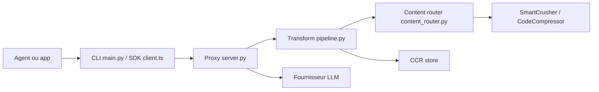

# headroomlabs-ai/headroom

> Proxy et bibliothèque locaux qui compressent le contexte envoyé aux LLM, pour qui utilise des agents de code.

## Le problème
Un agent relit des sorties d'outils, des logs et de l'historique à chaque tour : les tokens facturés gonflent sans que la réponse s'améliore.

## Ce que ça fait vraiment
Un ContentRouter choisit un compresseur selon le type de contenu : SmartCrusher (JSON), CodeCompressor (AST), Kompress-v2-base (texte). Seul le contenu nouveau est compressé, le préfixe reste identique pour préserver le cache du fournisseur. Les originaux sont gardés en local (CCR) et récupérables via `headroom_retrieve`. S'y ajoutent une mémoire partagée entre agents, `headroom learn` et un mode de réduction des tokens de sortie (désactivé par défaut).

## Comment c'est branché


## Essayer
```bash
uv tool install --python 3.13 "headroom-ai[all]"
headroom wrap claude
headroom proxy --port 8787
headroom doctor
headroom dashboard
```

## Coût et pièges
Le service est gratuit en open source ; la clé de ton fournisseur LLM reste à ta charge. Une balise de télémétrie anonyme est active par défaut (désactivable : `HEADROOM_BEACON=off`, `DO_NOT_TRACK=1`). Roues natives annoncées pour macOS Apple Silicon et Linux, Intel macOS passe par Docker.

## Ce que ce n'est pas
Pas un gain garanti : les chiffres du README (21 à 57 % sur quatre scénarios) sont ceux de l'auteur et fondent sur la répétitivité des charges ; la prose et les sorties denses compressent très peu. L'offre Enterprise (routage automatique, sécurité) est payante et hors du dépôt.

## Alternatives
- Compresr, Token Co. : API hébergée, mais le texte part chez eux et rien n'est réversible.
- OpenAI Compaction : natif du fournisseur, limité à l'historique de conversation.

## Pour toi
À adopter si tu fais tourner des agents de code toute la journée : on le branche sans toucher au code et on mesure l'économie sur son propre trafic avec `headroom savings`.

