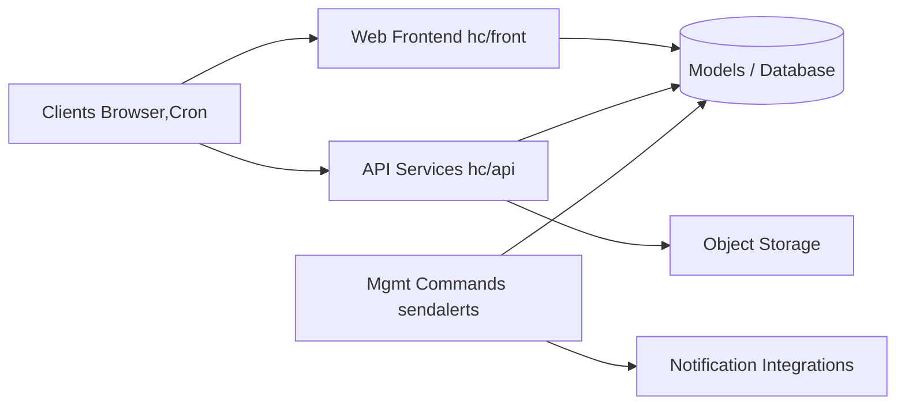

# healthchecks/healthchecks

> Django service for monitoring cron jobs: alerts when an expected ping does not arrive.

## The problem
A cron or scheduled job that fails silently goes unnoticed for days.

## What it actually does
Each "check" receives HTTP or email pings; period + grace time or cron expression (via cronsim). `sendalerts` watches the database and notifies through 25+ integrations (Slack, Telegram, Signal, Matrix, PagerDuty, Apprise, shell commands). Live dashboard, API, badges, monthly reports, WebAuthn 2FA, teams and projects. Python 3.12+, Django, PostgreSQL/MySQL/MariaDB (SQLite by default in dev); optional S3 storage of ping bodies.

## How it is wired


## Trying it
```bash
python3 -m venv .venv
source .venv/bin/activate
git clone https://github.com/healthchecks/healthchecks.git
pip install -r healthchecks/requirements.txt -r healthchecks/requirements-dev.txt
cd ~/webapps/healthchecks
./manage.py migrate
./manage.py createsuperuser
./manage.py runserver
```

## Cost and gotchas
Free, BSD-3 when self-hosted; healthchecks.io as a hosted service. `sendalerts` must run continuously; a reverse proxy is mandatory (X-Forwarded-For).

## What it is not
Not metrics monitoring nor active HTTP uptime monitoring: it passively waits for pings.

## Alternatives
None named in the README.

## For you
Worth watching: simple and reliable for being alerted when a scheduled ingestion or retraining job does not run; a `curl` at the end of the script is enough.
