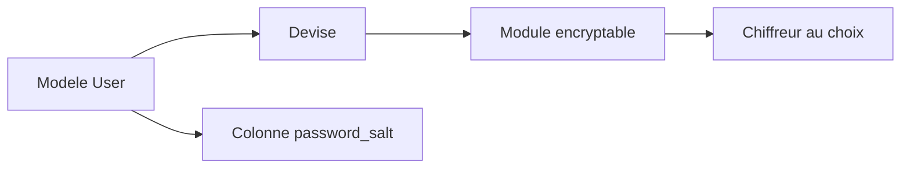

# heartcombo/devise-encryptable

> Devise extension for Rails that allows using other password hashing algorithms.

## The problem
Devise imposes its default hashing, which gets in the way of taking over an existing password database.

## What it actually does
Adds the `encryptable` module to a Devise model, with a `password_salt` column. It lets you use other encryptors, or your own. The README gives no further detail.

## How it is wired
Simplified diagram based on the sheet, no diagram provided.



## Trying it
```bash
gem "devise-encryptable"
```
Then `devise :database_authenticatable, :encryptable` in the model and a migration adding `password_salt`.

## Cost and gotchas
Free. Requires Ruby, Rails and Devise, and a database migration; this requirement is not in the list of prerequisites.

## What it is not
Not a complete security tool: it does not say which encryptors are safe. Not usable outside Rails.

## Alternatives
No alternative named in the README.

## For you
Ignore: a Ruby authentication building block, unrelated to data, AI or MLOps work.
