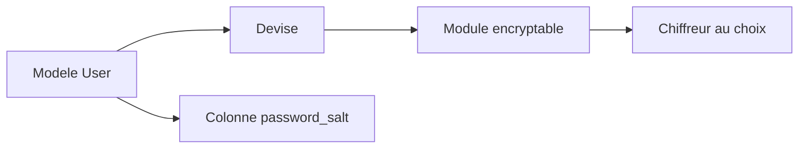

# heartcombo/devise-encryptable

> Extension Devise pour Rails qui permet d'utiliser d'autres algorithmes de hachage de mot de passe.

## Le problème
Devise impose son hachage par défaut, ce qui gêne la reprise d'une base de mots de passe existante.

## Ce que ça fait vraiment
Ajoute le module `encryptable` à un modèle Devise, avec une colonne `password_salt`. Il permet d'employer d'autres chiffreurs, ou le sien. Le README ne détaille rien de plus.

## Comment c'est branché
Schéma simplifié d'après la fiche, sans diagramme fourni.



## Essayer
```bash
gem "devise-encryptable"
```
Puis `devise :database_authenticatable, :encryptable` dans le modèle et une migration ajoutant `password_salt`.

## Coût et pièges
Gratuit. Il faut Ruby, Rails et Devise, et une migration de base de données ; ce besoin n'entre pas dans la liste des prérequis.

## Ce que ce n'est pas
Pas un outil de sécurité complet : il ne dit pas quels chiffreurs sont sûrs. Pas utilisable hors Rails.

## Alternatives
Aucune alternative nommée dans le README.

## Pour toi
Ignorer : brique d'authentification Ruby, sans lien avec un travail data, IA ou MLOps.

