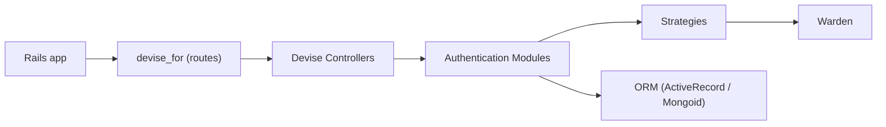

# heartcombo/devise

> Modular authentication solution for Rails, built on Warden, for Rails developers.

## The problem
Writing sign-up, login, confirmation, password reset and lockout yourself is long and risky.

## What it actually does
A Rails gem (engine) made of 10 modules: database authenticatable, omniauthable, confirmable, recoverable, registerable, rememberable, trackable, timeoutable, validatable, lockable. View and controller generators, several models signed in at the same time, ActiveRecord and Mongoid support, Hotwire/Turbo, OmniAuth. Version 5 requires Rails 7 or later.

## How it is wired


## Trying it
```bash
bundle add devise
rails generate devise:install
rails generate devise MODEL
rails db:migrate
```

## Cost and gotchas
Free. Reset tokens can leak into Rails logs (the README advises `log_level = :warn`). Do not use it for a first Rails app, says the README.

## What it is not
Not authorization (permissions); not an external identity service.

## Alternatives
No alternative named in the README.

## For you
Outside Python/ML; ignore unless a Rails app is part of your stack.
