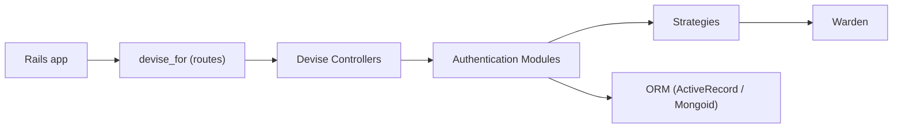

# heartcombo/devise

> Solution d'authentification modulaire pour Rails, fondée sur Warden, pour développeurs Rails.

## Le problème
Écrire soi-même inscription, connexion, confirmation, réinitialisation de mot de passe et verrouillage est long et risqué.

## Ce que ça fait vraiment
Gem Rails (moteur) composée de 10 modules : database authenticatable, omniauthable, confirmable, recoverable, registerable, rememberable, trackable, timeoutable, validatable, lockable. Générateurs de vues et contrôleurs, plusieurs modèles connectés en parallèle, support ActiveRecord et Mongoid, Hotwire/Turbo, OmniAuth. La version 5 demande Rails 7 ou plus.

## Comment c'est branché


## Essayer
```bash
bundle add devise
rails generate devise:install
rails generate devise MODEL
rails db:migrate
```

## Coût et pièges
Gratuit. Les jetons de réinitialisation peuvent fuiter dans les logs Rails (README conseille `log_level = :warn`). Ne pas l'utiliser pour une première appli Rails, dit le README.

## Ce que ce n'est pas
Pas de l'autorisation (droits) ; pas un service d'identité externe.

## Alternatives
Aucune alternative nommée dans le README.

## Pour toi
Hors Python/ML ; à ignorer sauf si une appli Rails fait partie de ta stack.

