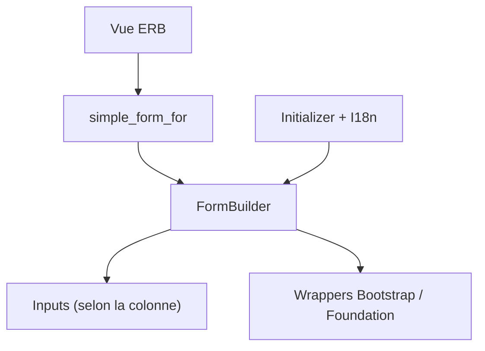

# heartcombo/simple_form

> Ruby gem that simplifies building Rails forms with labels, hints and errors.

## The problem
Rails form helpers require a lot of repetitive code for labels, errors and hints.

## What it actually does
A `simple_form_for` DSL maps each database column to the right field type and generates label, hint, error and field. It offers wrappers for Bootstrap 5 and Foundation 5, collections, associations, custom inputs and I18n.

## How it is wired
Simplified diagram based on the sheet, no diagram provided.


## Trying it
```bash
bundle install
rails generate simple_form:install
rails generate simple_form:install --bootstrap
```

## Cost and gotchas
Free, with Rails. Association is mostly tested with Active Record, and works poorly with Mongoid according to the README. The Foundation wrappers do not handle default hints.

## What it is not
It is not a form framework independent of Rails. It inherits Formtastic's DSL, without replacing it.

## Alternatives
No alternative named in the README, except Formtastic which it inherits from.

## For you
Ignore: useful only if you build a Rails web interface around a data tool, otherwise of no interest for your profile.
