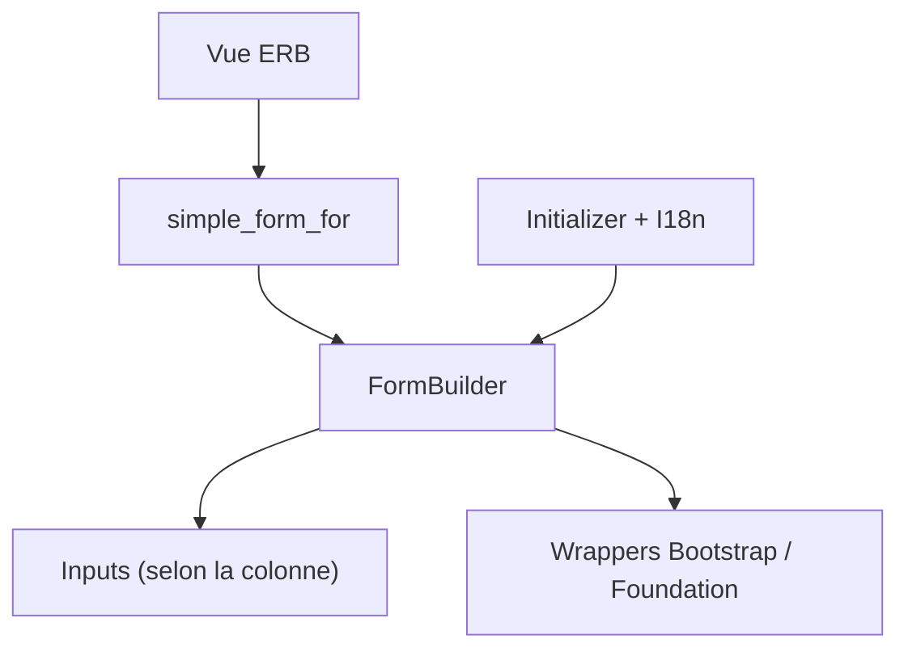

# heartcombo/simple_form

> Gem Ruby qui simplifie la création de formulaires Rails avec labels, aides et erreurs.

## Le problème
Les helpers de formulaire de Rails demandent beaucoup de code répétitif pour labels, erreurs et aides.

## Ce que ça fait vraiment
Un DSL `simple_form_for` mappe chaque colonne de base de données vers le bon type de champ et génère étiquette, aide, erreur et champ. Il propose des wrappers pour Bootstrap 5 et Foundation 5, des collections, associations, des entrées personnalisées et l'I18n.

## Comment c'est branché
Schéma simplifié d'après la fiche, sans diagramme fourni.


## Essayer
```bash
bundle install
rails generate simple_form:install
rails generate simple_form:install --bootstrap
```

## Coût et pièges
Gratuit, avec Rails. L'association est testée surtout avec Active Record, et marche mal avec Mongoid selon le README. Les wrappers Foundation ne gèrent pas les aides par défaut.

## Ce que ce n'est pas
Ce n'est pas un framework de formulaires indépendant de Rails. Il hérite du DSL de Formtastic, sans le remplacer.

## Alternatives
Aucune alternative nommée dans le README, sauf Formtastic dont il hérite.

## Pour toi
À ignorer : utile seulement si tu bâtis une interface web Rails autour d'un outil data, sinon sans intérêt pour ton profil.

