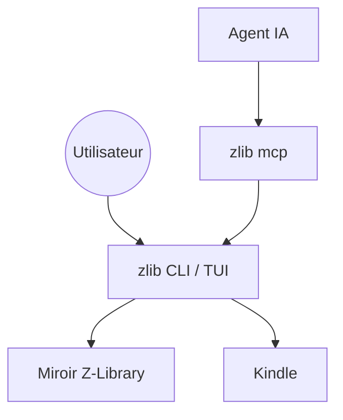

# heartleo/zlib

> Command-line client for Z-Library, also usable by AI agents via plugin or MCP.

## The problem
Searching for and downloading books on Z-Library goes through a website whose domains change and which requires an account.

## What it actually does
A CLI and a terminal interface: filtered search (year, language, format), favorites, recommendations, history, daily quota, download, sending to Kindle. `zlib doctor` finds a reachable mirror. A Claude Code and Codex plugin, or an MCP server (`zlib mcp`, `--read-only` option), exposes these actions to agents.

## How it is wired
Simplified diagram based on the sheet, no diagram provided.


## Trying it
```bash
brew install heartleo/tap/zlib
zlib doctor
zlib login --domain https://z-lib.gd
zlib search "dune" --ext epub
```

## Cost and gotchas
A Z-Library account is required, with a daily download quota. The third-party service may disappear or change domain. Downloads depend on the legality of the content in your country.

## What it is not
Not an official service nor a general-purpose document search tool.

## Alternatives
No alternative named in the README.

## For you
Ignore: depends on a third-party service of uncertain legal status and brings nothing to data, AI or MLOps work.
