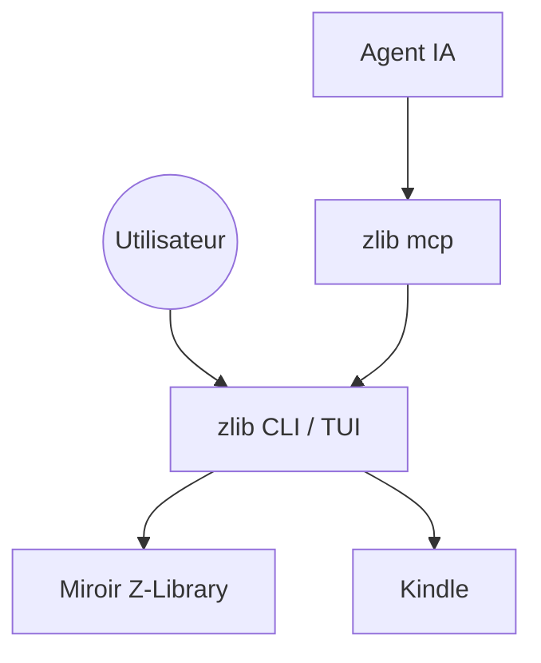

# heartleo/zlib

> Client en ligne de commande pour Z-Library, utilisable aussi par des agents IA via plugin ou MCP.

## Le problème
Chercher et télécharger des livres sur Z-Library passe par un site web dont les domaines changent et qui demande un compte.

## Ce que ça fait vraiment
Une CLI et une interface terminal : recherche filtrée (année, langue, format), favoris, recommandations, historique, quota quotidien, téléchargement, envoi vers Kindle. `zlib doctor` trouve un miroir joignable. Un plugin Claude Code et Codex, ou un serveur MCP (`zlib mcp`, option `--read-only`), expose ces actions aux agents.

## Comment c'est branché
Schéma simplifié d'après la fiche, sans diagramme fourni.


## Essayer
```bash
brew install heartleo/tap/zlib
zlib doctor
zlib login --domain https://z-lib.gd
zlib search "dune" --ext epub
```

## Coût et pièges
Un compte Z-Library est nécessaire, avec un quota de téléchargements quotidien. Le service tiers peut disparaître ou changer de domaine. Les téléchargements dépendent de la légalité du contenu dans ton pays.

## Ce que ce n'est pas
Ce n'est pas un service officiel ni un outil de recherche documentaire généraliste.

## Alternatives
Aucune alternative nommée dans le README.

## Pour toi
À ignorer : dépend d'un service tiers au statut juridique incertain et n'apporte rien à un travail de data, d'IA ou de MLOps.

