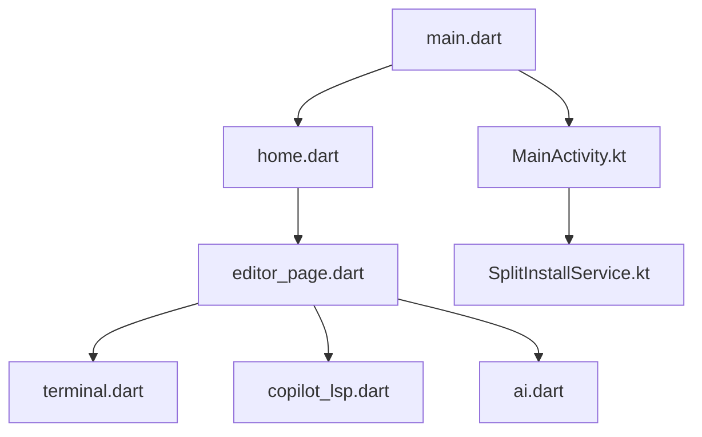

# heckmon/roxum-ide

> Code editor and mini IDE for Android in Flutter, with terminal, Git and AI assistance.

## The problem
Program from a phone without a full mobile editor.

## What it actually does
Editing with LSP, built-in terminal, Git and GitHub, SSH, 245 themes, offline compilers, AI completion with local GGUF models or external providers for agentic editing. Language modules are downloaded on demand through the App Bundle. v3 plans an `rx` package manager.

## How it is wired


## Trying it
```bash
cd android && ./gradlew :app:bundleRelease
java -jar path/to/bundletool.jar build-apks --bundle=your_app/build/app/outputs/bundle/release/app-release.aab --output=output.apks --mode=universal
```

## Cost and gotchas
Free. Building requires Git LFS, Flutter and the Android tools. The README admits to defects and a large size; some changes might leave the Play Store.

## What it is not
Not a desktop IDE: the editor is designed for a phone screen.

## Alternatives
No alternative named in the README.

## For you
Ignore: niche mobile editor; for AI-assisted code, a desktop editor with LSP remains more practical.
