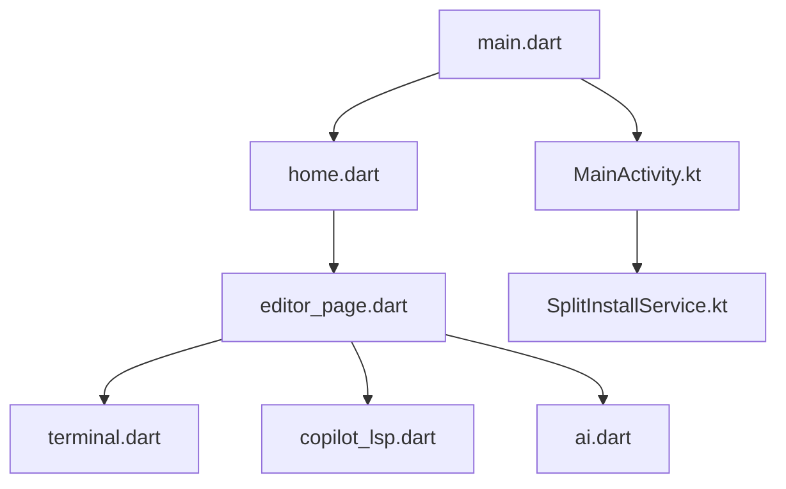

# heckmon/roxum-ide

> Éditeur de code et mini IDE pour Android en Flutter, avec terminal, Git et assistance IA.

## Le problème
Programmer depuis un téléphone sans éditeur mobile complet.

## Ce que ça fait vraiment
Édition avec LSP, terminal intégré, Git et GitHub, SSH, 245 thèmes, compilateurs hors ligne, complétion IA avec modèles GGUF locaux ou fournisseurs externes pour l'édition agentique. Les modules de langage se téléchargent à la demande via l'App Bundle. La v3 prévoit un gestionnaire de paquets `rx`.

## Comment c'est branché


## Essayer
```bash
cd android && ./gradlew :app:bundleRelease
java -jar path/to/bundletool.jar build-apks --bundle=your_app/build/app/outputs/bundle/release/app-release.aab --output=output.apks --mode=universal
```

## Coût et pièges
Gratuit. Compiler exige Git LFS, Flutter et les outils Android. Le README reconnaît des défauts et un poids important ; des changements pourraient quitter le Play Store.

## Ce que ce n'est pas
Pas un IDE de bureau : l'éditeur est conçu pour un écran de téléphone.

## Alternatives
Aucune alternative nommée dans le README.

## Pour toi
À ignorer : éditeur mobile de niche ; pour du code IA, un éditeur de bureau avec LSP reste plus pratique.

