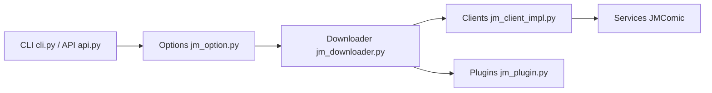

# hect0x7/JMComic-Crawler-Python

> Python API and CLI to download albums from the JMComic site, with Cloudflare bypass.

## The problem
Fetching and decoding the album images of one specific site that has no public API.

## What it actually does
Provides a synchronous and asynchronous API, a CLI (`jmcomic`, `jmv`), a YAML options system, 21 plugins (PDF, zip, long image, favorites) and a GitHub Actions downloader. Handles search, comments, rankings, favorites and mobile client authentication.

## How it is wired


## Trying it
```bash
pip install jmcomic -U
jmcomic 123
```

## Cost and gotchas
Free. The targeted content is adult content (the README talks about anti-bot "bypass"); legal and site-blocking risks. Do not download in bulk.

## What it is not
Not a general-purpose scraping tool nor a professional project. Documentation sometimes lags behind, by the author's own admission.

## Alternatives
No alternative named in the README.

## For you
Ignore: a subject unrelated to your work and a legally sensitive area.
