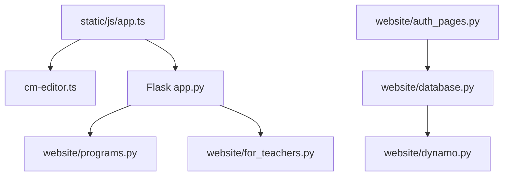

# hedyorg/hedy

> Gradual programming language for teaching programming and Python, level by level.

## The problem
A beginner facing Python stumbles on the syntax before understanding the ideas.

## What it actually does
Hedy offers successive levels: the first only lets you print text and ask questions, then the syntax grows richer until it reaches Python. Students edit in the browser, the Flask server analyzes the code. Teachers manage classes. The project is translated via Weblate.

## How it is wired

## Trying it
No command is documented in the README; it points to hedy.org and the wiki (Offline Hedy).

## Cost and gotchas
Free to use on hedy.org. Local installation follows the wiki, the database is DynamoDB (AWS). The project accepts few pull requests outside its goals.

## What it is not
Not a tool for data scientists: it is an educational tool for beginners.

## Alternatives
No alternative named in the README.

## For you
Ignore for your own work; useful if you run programming introduction workshops.
