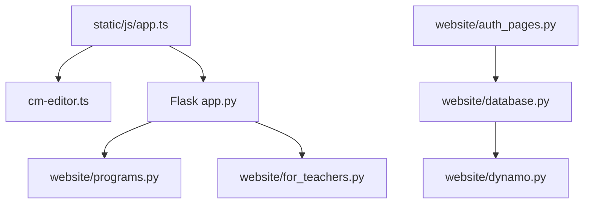

# hedyorg/hedy

> Langage de programmation graduel pour enseigner la programmation et Python, par niveaux.

## Le problème
Un débutant, face à Python, bute sur la syntaxe avant de comprendre les idées.

## Ce que ça fait vraiment
Hedy propose des niveaux successifs : le premier ne permet que d'afficher du texte et de poser des questions, puis la syntaxe s'enrichit jusqu'à Python. Les élèves éditent dans le navigateur, le serveur Flask analyse le code. Les enseignants gèrent des classes. Le projet est traduit via Weblate.

## Comment c'est branché

## Essayer
Aucune commande n'est documentée dans le README ; il renvoie à hedy.org et au wiki (Offline Hedy).

## Coût et pièges
Usage gratuit sur hedy.org. L'installation locale suit le wiki, la base est DynamoDB (AWS). Le projet accepte peu de pull requests hors de ses objectifs.

## Ce que ce n'est pas
Ce n'est pas un outil pour data scientists : c'est un outil pédagogique pour débutants.

## Alternatives
Aucune alternative nommée dans le README.

## Pour toi
À ignorer pour ton propre travail ; utile si tu animes des ateliers d'initiation à la programmation.

