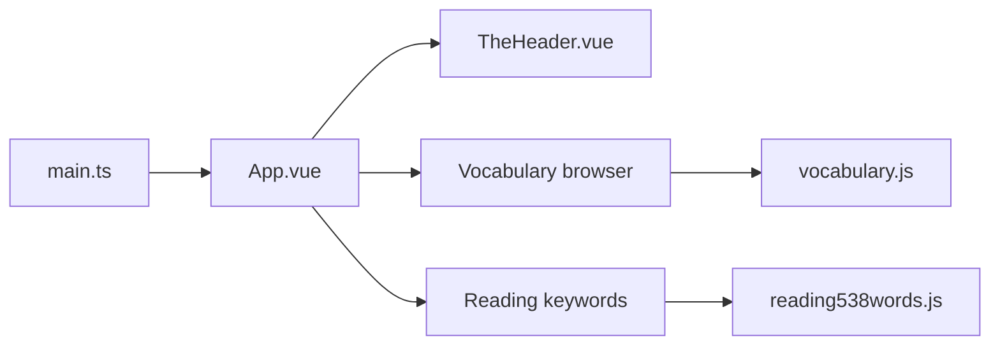

# hefengxian/my-ielts

> IELTS preparation website: vocabulary, grammar, listening, reading and writing, in Chinese.

## The problem
IELTS resources are scattered across books, videos and flashcards, with no unified interactive practice.

## What it actually does
A static Vue 3 site with hash routing: vocabulary browser and typing exercises, audio, 179 listening keywords, 538 reading synonyms, 100 sentences to translate, grammar (video link and handout). Speaking is marked TODO. Vitesse Lite template, styles inspired by Flowbite.

## How it is wired


## Trying it
```bash
pnpm i
pnpm run dev
pnpm run build
```

## Cost and gotchas
Free. No license declared, and the README forbids any commercial use: reuse is legally unclear. The content draws on third-party books and courses.

## What it is not
Not a complete course: some sections are WIP or TODO. The interface is in Chinese.

## Alternatives
No alternative named in the README.

## For you
Ignore: language exam preparation unrelated to your work, and no license.
