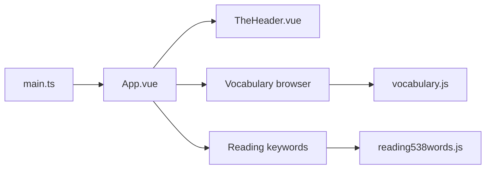

# hefengxian/my-ielts

> Site web de préparation à l'IELTS : vocabulaire, grammaire, écoute, lecture et écriture, en chinois.

## Le problème
Les ressources IELTS sont dispersées entre livres, vidéos et fiches, sans entraînement interactif unifié.

## Ce que ça fait vraiment
Site Vue 3 statique à routage par hash : navigateur et exercices de saisie de vocabulaire, audios, 179 mots clés d'écoute, 538 synonymes de lecture, 100 phrases à traduire, grammaire (lien vidéo et polycopié). L'oral est marqué TODO. Modèle Vitesse Lite, styles inspirés de Flowbite.

## Comment c'est branché


## Essayer
```bash
pnpm i
pnpm run dev
pnpm run build
```

## Coût et pièges
Gratuit. Aucune licence déclarée, et le README interdit tout usage commercial : réutilisation juridiquement floue. Les contenus reprennent des livres et cours tiers.

## Ce que ce n'est pas
Pas un cours complet : certaines sections sont WIP ou TODO. Interface en chinois.

## Alternatives
Aucune alternative nommée dans le README.

## Pour toi
Ignorer : préparation d'examen de langue sans rapport avec ton métier, et licence absente.

