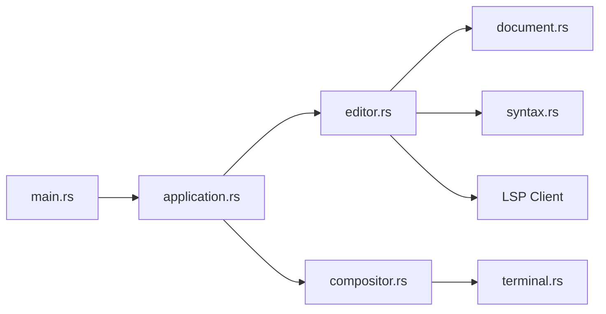

# helix-editor/helix

> Modal text editor for the terminal written in Rust, inspired by Kakoune and Neovim, with LSP and tree-sitter.

## The problem
Configuring Vim or Neovim with plugins to get LSP and syntax highlighting takes time.

## What it actually does
Modal editing with multiple selections, built-in language server (LSP), incremental highlighting and editing via tree-sitter, DAP debugging, VCS integration, pickers and completion. The README admits that only some languages have indentation definitions.

## How it is wired

## Trying it
No command in the README: installation is deferred to the documentation, launched with `hx` according to the architecture.

## Cost and gotchas
Free. Little configuration, but you have to learn a different editing model (selection then action). No plugin ecosystem documented here.

## What it is not
Not an IDE: no notebooks, no Jupyter integration.

## Alternatives
Kakoune and Neovim, cited as sources of inspiration.

## For you
Worth watching: pleasant for editing Python or YAML over SSH on a compute server, but without notebooks you keep VS Code for data work.
