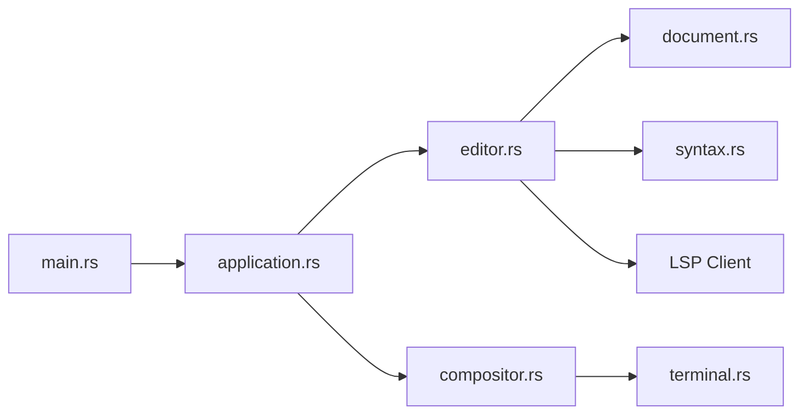

# helix-editor/helix

> Éditeur de texte modal en terminal écrit en Rust, inspiré de Kakoune et Neovim, avec LSP et tree-sitter.

## Le problème
Configurer Vim ou Neovim avec plugins pour obtenir LSP et coloration syntaxique demande du temps.

## Ce que ça fait vraiment
Édition modale avec sélections multiples, serveur de langage (LSP) intégré, coloration et édition incrémentales par tree-sitter, débogage DAP, intégration VCS, sélecteurs et complétion. Le README admet que seuls certains langages ont des définitions d'indentation.

## Comment c'est branché

## Essayer
Aucune commande dans le README : installation renvoyée à la documentation, lancement par `hx` d'après l'architecture.

## Coût et pièges
Gratuit. Peu de configuration, mais il faut apprendre un modèle d'édition différent (sélection puis action). Pas d'écosystème de plugins documenté ici.

## Ce que ce n'est pas
Pas un IDE : pas de notebooks, pas d'intégration Jupyter.

## Alternatives
Kakoune et Neovim, cités comme sources d'inspiration.

## Pour toi
À surveiller : agréable pour éditer du Python ou du YAML en SSH sur un serveur de calcul, mais sans notebooks tu gardes VS Code pour le travail data.

