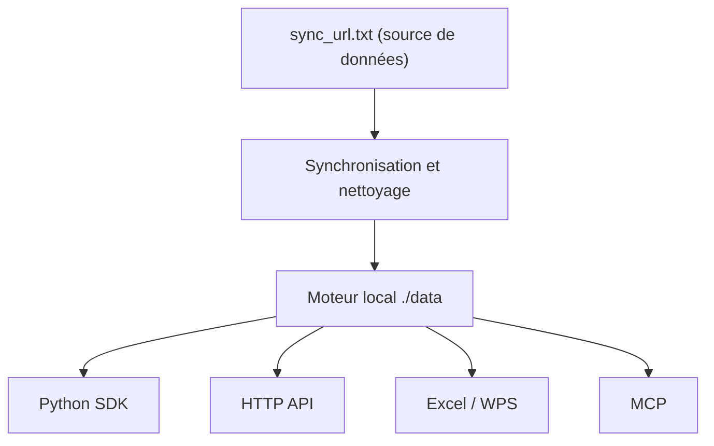

# hello245m/free-stockdb

> Local engine for Chinese stock market data (A-shares) for quantitative research, with 39 built-in indicators.

## The problem
To backtest on 7000 stocks, remote APIs impose quotas, IP blocking and several days of downloading.

## What it actually does
Synchronizes quotes (daily, minute, tick), cleans them, computes adjustment factors and stores them locally in zstd. A C++ service serves queries on `127.0.0.1:7899`, with a Rust compute core for 39 indicators and 5 indices. Access through Python, HTTP, Excel/WPS, HTML and MCP. A private storage lets you write your own data.

## How it is wired


## Trying it
```bash
cmake -S cpp -B cpp/build
cmake --build cpp/build --config Release
```

## Cost and gotchas
Free; 5 to 20 GB of disk, 2 GB of RAM at minimum. Prebuilt binaries mainly target Windows. Rights to the data depend on the configured source: check them yourself. The announced time savings are the README's, unverified.

## What it is not
Not a data provider: it depends on one. Not investment advice. README in Chinese only; Chinese market only.

## Alternatives
Not documented in the README (it targets "remote APIs" in general).

## For you
Worth watching: interesting only if you work on Chinese markets; otherwise irrelevant. Recent project, by a single person.
