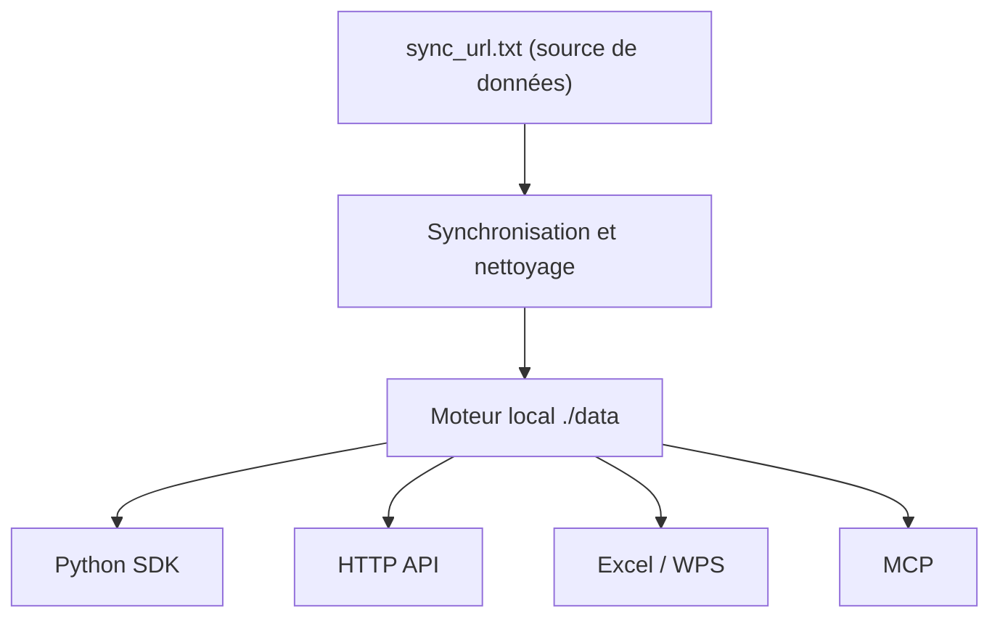

# hello245m/free-stockdb

> Moteur local de données boursières chinoises (A-shares) pour la recherche quantitative, avec 39 indicateurs intégrés.

## Le problème
Pour backtester sur 7000 actions, les API distantes imposent quotas, blocages d'IP et plusieurs jours de téléchargement.

## Ce que ça fait vraiment
Synchronise des cotations (jour, minute, tick), les nettoie, calcule les facteurs d'ajustement et les stocke localement en zstd. Un service C++ sert les requêtes sur `127.0.0.1:7899`, avec un cœur de calcul Rust pour 39 indicateurs et 5 indices. Accès par Python, HTTP, Excel/WPS, HTML et MCP. Un stockage privé permet d'écrire ses propres données.

## Comment c'est branché


## Essayer
```bash
cmake -S cpp -B cpp/build
cmake --build cpp/build --config Release
```

## Coût et pièges
Gratuit ; 5 à 20 Go de disque, 2 Go de RAM au minimum. Les binaires précompilés ciblent surtout Windows. Les droits sur les données dépendent de la source configurée : à vérifier soi-même. Les temps de gain annoncés sont ceux du README, non vérifiés.

## Ce que ce n'est pas
Pas un fournisseur de données : il en dépend. Ni conseil d'investissement. README en chinois uniquement ; marché chinois seulement.

## Alternatives
Non documenté dans le README (il vise « les API distantes » en général).

## Pour toi
À surveiller : intéressant seulement si tu travailles sur les marchés chinois ; sinon sans objet. Projet récent, d'une seule personne.

