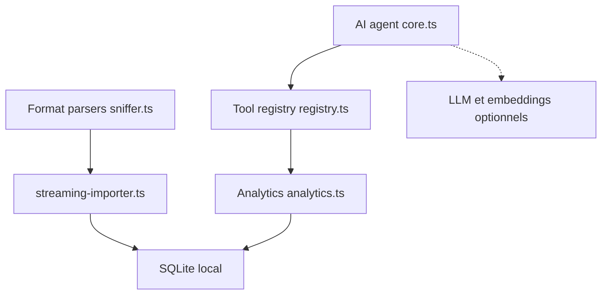

# hellodigua/ChatLab

> Local desktop application to analyze your conversation histories with SQL and AI agents.

## The problem
WhatsApp, Telegram or Discord histories are hard to explore and query without sending them to a cloud.

## What it actually does
ChatLab imports exports from WhatsApp, LINE, QQ, Discord, Instagram, Telegram, iMessage and Google Chat into a local SQLite database, through a unified format. It offers statistics and visualizations, an agent with more than 24 tools, a semantic index (local embeddings or API) and an MCP server. Variants: Electron, CLI with web interface, browser WASM.

## How it is wired


## Trying it
```bash
npm i chatlab-cli -g
clb web
clb web --headless
clb web --daemon
```

## Cost and gotchas
Free. AI features call the LLM provider you configure (API key at your expense); without it, everything stays local. Development: Node 24 and pnpm 11.

## What it is not
Not a cloud service. Messenger and KakaoTalk are announced as coming. The AGPL license imposes conditions if you host it for third parties.

## Alternatives
No alternative named in the README.

## For you
Worth watching: a useful example of a local SQL plus agent plus MCP stack, and a direct tool to analyze your own exports.
