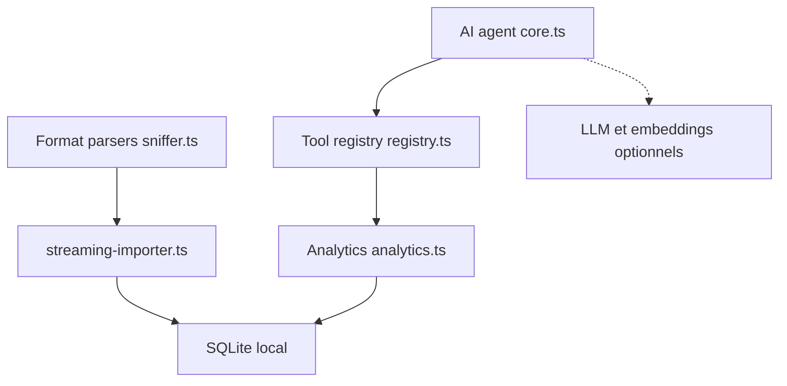

# hellodigua/ChatLab

> Application de bureau locale pour analyser ses historiques de conversations avec SQL et agents IA.

## Le problème
Les historiques WhatsApp, Telegram ou Discord sont difficiles à explorer et à interroger sans les envoyer dans un cloud.

## Ce que ça fait vraiment
ChatLab importe les exports de WhatsApp, LINE, QQ, Discord, Instagram, Telegram, iMessage et Google Chat dans une base SQLite locale, via un format unifié. Il propose statistiques et visualisations, un agent avec plus de 24 outils, un index sémantique (embeddings locaux ou API) et un serveur MCP. Variantes : Electron, CLI avec interface web, WASM navigateur.

## Comment c'est branché


## Essayer
```bash
npm i chatlab-cli -g
clb web
clb web --headless
clb web --daemon
```

## Coût et pièges
Gratuit. Les fonctions IA appellent le fournisseur LLM que tu configures (clé d'API à ta charge) ; sans cela, tout reste local. Développement : Node 24 et pnpm 11.

## Ce que ce n'est pas
Pas un service cloud. Messenger et KakaoTalk sont annoncés comme à venir. La licence AGPL impose des conditions si tu l'héberges pour des tiers.

## Alternatives
Aucune alternative nommée dans le README.

## Pour toi
À surveiller : exemple utile de pile locale SQL plus agent plus MCP, et outil direct pour analyser tes propres exports.

