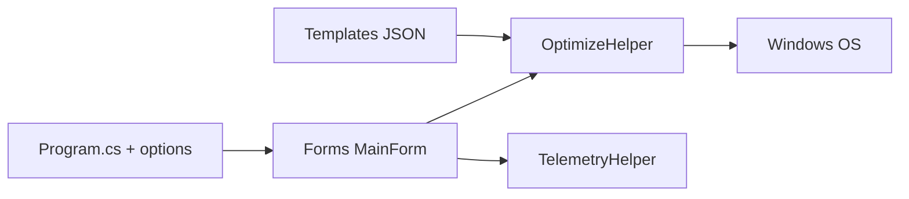

# hellzerg/optimizer

> Windows privacy and system-tweaking utility, now archived and replaced by OptimizerNXT.

## The problem
After a Windows installation, telemetry, services and preinstalled apps degrade privacy and performance.

## What it actually does
WinForms application (.NET Framework 4.8.1): disables Windows and Office telemetry, Cortana, Copilot, updates, unneeded services; uninstalls UWP apps; cleans disk and browsers; HOSTS editor, DNS, ping, locked files. Support for 24 languages, silent execution via JSON templates, command-line options.

## How it is wired

## Trying it
No installation command: download from the Releases page. Documented option: `Optimizer /disabledefender` (safe mode) or `/restart=disabledefender`.

## Cost and gotchas
Free (GPL-3.0). Archived repository: the README announces the deprecation. Latest version 16.7 (August 2024). Modifies the system deeply, including Defender.

## What it is not
No longer maintained: follow OptimizerNXT. Not an audited security tool.

## Alternatives
OptimizerNXT, the successor announced in the README.

## For you
Archived and Windows-centered: ignore.
