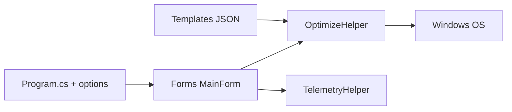

# hellzerg/optimizer

> Utilitaire Windows de confidentialité et de réglages système, désormais archivé et remplacé par OptimizerNXT.

## Le problème
Après une installation de Windows, télémétrie, services et applications préinstallées dégradent la vie privée et les performances.

## Ce que ça fait vraiment
Application WinForms (.NET Framework 4.8.1) : désactive télémétrie Windows et Office, Cortana, Copilot, mises à jour, services inutiles ; désinstalle des applications UWP ; nettoie disque et navigateurs ; éditeur de HOSTS, DNS, ping, fichiers verrouillés. Support de 24 langues, exécution silencieuse par gabarits JSON, options en ligne de commande.

## Comment c'est branché

## Essayer
Aucune commande d'installation : téléchargement depuis la page Releases. Option documentée : `Optimizer /disabledefender` (mode sans échec) ou `/restart=disabledefender`.

## Coût et pièges
Gratuit (GPL-3.0). Dépôt archivé : le README annonce la dépréciation. Dernière version 16.7 (août 2024). Modifie le système en profondeur, y compris Defender.

## Ce que ce n'est pas
Plus maintenu : suivre OptimizerNXT. Pas un outil de sécurité audité.

## Alternatives
OptimizerNXT, successeur annoncé dans le README.

## Pour toi
Archivé et centré sur Windows : à ignorer.

