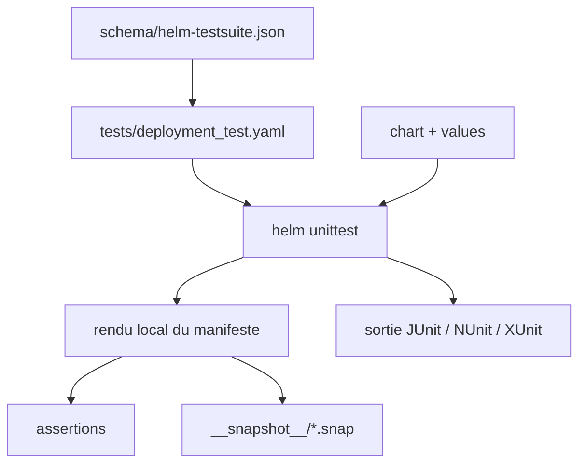

# helm-unittest/helm-unittest

> Helm plugin that tests a chart's rendering as YAML, locally, without creating anything on the cluster.

## The problem
A change to a Helm chart can only be checked at deployment, so on a real cluster and too late.
`helm lint` validates the form, not the content of the manifest actually produced.

## What it actually does
Tests are written in plain YAML in `tests/*_test.yaml`: you set values, select templates, and make assertions (`isKind`, `equal`, `matchRegex`).
Renders the chart locally and creates nothing on the cluster.
Supports snapshot testing (`matchSnapshot`), with snapshots versioned in `__snapshot__/*.snap` next to the tests.
Selects a document with `documentSelector` with JsonPath support, tests dependent subcharts from the root chart, and accepts suites generated by a test chart (`--chart-tests-path`).

## How it is wired


## Trying it
```bash
helm plugin install https://github.com/helm-unittest/helm-unittest.git
helm unittest $YOUR_CHART
helm unittest -u my-chart
helm unittest --parallel --max-workers 4 ./charts/my-app
docker run -ti --rm -v $(pwd):/apps helmunittest/helm-unittest
```

## Cost and gotchas
With Helm 4, installing from the git repository requires `--verify=false`: GPG verification via webhook is not supported.
The OCI download bundles all OSes and architectures, hence a heavier package, and only exists from version 1.1.0.
`--max-workers` has no effect without `--parallel`, and `--parallel` is ignored if `--debugPlugin` is set.

## What it is not
It is not `helm test`, which creates a test pod on the cluster.
It is not a deployment validator: a manifest rendering successfully does not guarantee it will apply.
Remember to add `tests` to `.helmignore`, and to ignore `*/__snapshot__/*` with generated suites.

## Alternatives
- pytest-helm-charts: same need from Python, if the team prefers writing tests as code.
- terratest: Go equivalent, for infrastructure tests broader than rendering alone.

## For you
Adopt as soon as you maintain a Helm chart that others deploy; the entry cost is measured in minutes.
