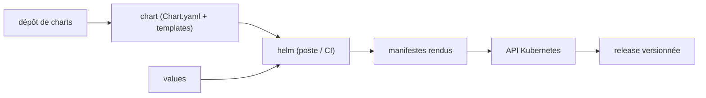

# helm/helm

> Package manager for Kubernetes: installs and versions packaged applications.

## The problem
Deploying a Kubernetes application means maintaining dozens of nearly identical YAML manifests.
Replaying a deployment identically, or rolling it back, is not native.

## What it actually does
A chart is a package containing at minimum a `Chart.yaml` and Kubernetes manifest templates.
Helm renders the templates locally then talks to the Kubernetes API; it runs on your machine or in CI.
Charts live on disk or in remote repositories, like Debian or RedHat packages.
It manages *releases*: installed versions, upgrades, rollbacks.

## How it is wired


## Trying it
```bash
brew install helm
choco install kubernetes-helm
winget install Helm.Helm
scoop install helm
snap install helm --classic
mise use -g helm@latest
```

## Cost and gotchas
Free, but you need an accessible Kubernetes cluster — that is where the real bill is.
Helm v3 is now in support-only mode: bug fixes until July 8, 2026, security fixes until November 11, 2026.

## What it is not
It is not a runtime: Helm renders and sends, it replaces neither the cluster nor `kubectl`.
It is not a generic configuration system: the output is Kubernetes manifests.
The README documents neither the license nor the project's governance.

## Alternatives
No alternative named in the README.

## For you
Unavoidable as soon as your models or pipelines run on Kubernetes; useless otherwise.
