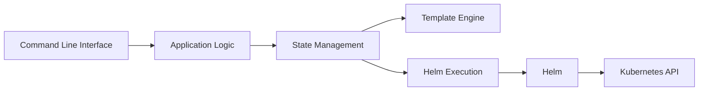

# helmfile/helmfile

> Declarative specification for deploying Helm charts, for teams that manage Kubernetes clusters.

## The problem
Helm deployments drift from one environment to another when they are not versioned.

## What it actually does
A `helmfile.yaml` file describes repositories and releases; `helmfile apply` synchronizes the cluster. It delegates to `helm` and the `helm-diff` plugin. It handles reusable modules, kustomizations and resource directories converted into Helm releases, and JSON or strategic-merge patches without forking the charts.

## How it is wired


## Trying it
```bash
helmfile create my-project && cd my-project
helmfile apply
```
After installation, run `helmfile init` once.

## Cost and gotchas
Free. Requires `helm` and `helm-diff`. Moving from v0 to v1.1 involves a few breaking changes.

## What it is not
Not a replacement for Helm: it calls it. It is not a continuous GitOps tool.

## Alternatives
The README names no alternative.

## For you
Worth watching: useful if you deploy MLOps services on Kubernetes via Helm, otherwise off topic.
