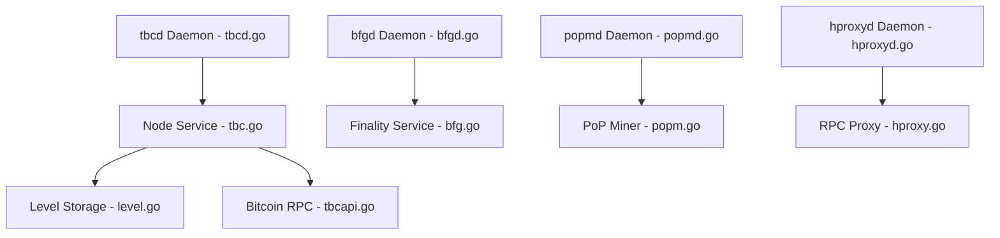

# hemilabs/heminetwork

> Go daemons of the Hemi network (an EVM L2 anchored on Bitcoin): Bitcoin node, finality, PoP miner, RPC proxy.

## The problem
An EVM-compatible L2 that wants to inherit Bitcoin's security needs services to read Bitcoin, expose finality and mine the proofs.

## What it actually does
Four daemons: `tbcd` (custom, embeddable Bitcoin node), `bfgd` (finality information via API), `popmd` (Proof-of-Proof miner with a Bitcoin wallet) and `hproxyd` (RPC request load balancing to Hemi's op-geth nodes). Also included are `btctool`, `hemictl` and `keygen`. The Hemi L2 node lives in another repository.

## How it is wired


## Trying it
```bash
git clone https://github.com/hemilabs/heminetwork.git
cd heminetwork
make deps
make install
```
Docker images exist: `hemilabs/bfgd`, `hemilabs/hproxyd`, `hemilabs/popmd`, `hemilabs/tbcd`.

## Cost and gotchas
Go 1.26+, `git`, `make`. Running `tbcd` means indexing Bitcoin (disk space not specified in the README). The PoP miner handles Bitcoin keys.

## What it is not
Not the full Hemi node (see hemilabs/hemi-node). Not a ready-to-use blockchain data analysis tool.

## Alternatives
- hemilabs/hemi-node: documentation and files for running the L2 nodes.

## For you
Ignore: blockchain infrastructure, far from the data/AI/MLOps profile, unless you work on Hemi itself.
