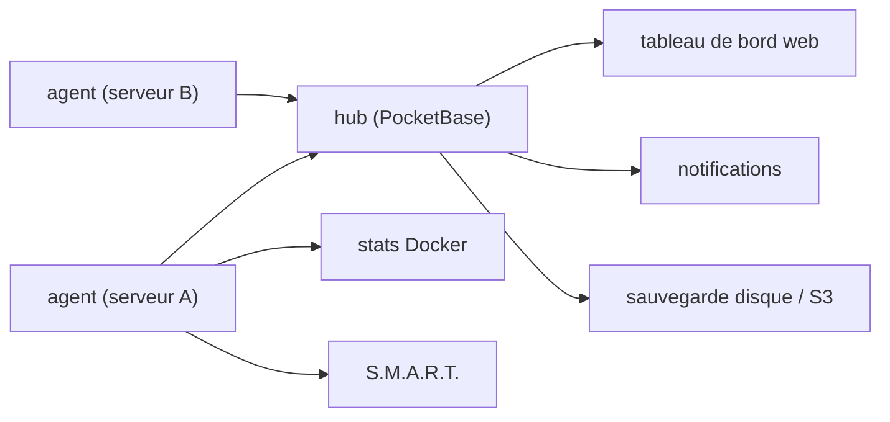

# henrygd/beszel

> Lightweight monitoring of servers and Docker containers, with history and alerts.

## The problem
Conventional monitoring solutions consume more resources than what they monitor.
Tracking CPU and memory usage per container usually requires deploying a full stack.

## What it actually does
Two components: a hub (a web application built on PocketBase) and an agent installed on each monitored machine.
The agent reports system metrics and, container by container, CPU, memory and network history.
Configurable alerts on most metrics, sent to many notification services; S.M.A.R.T. disk health with alerting on failure.
Multi-user with system sharing by administrators, OAuth2/OIDC (password login can be disabled), API, disk or S3 backups.

## How it is wired

## Trying it
The README contains no installation command: it points to the quick start guide on beszel.dev.

## Cost and gotchas
Free; an agent must be installed and maintained on each monitored machine.
The author warns that they cannot always reply and asks users to search existing issues first.

## What it is not
It is not an application observability system: machine and container metrics, no traces or logs.
It is not a managed offering: the hub is an application you host yourself.
The README declares no license, no precise prerequisites and no installation method.

## Alternatives
No alternative is named in the README, only an implicit comparison with the "leading solutions".

## For you
Useful for monitoring a training server or a compute machine without setting up a Prometheus stack.
