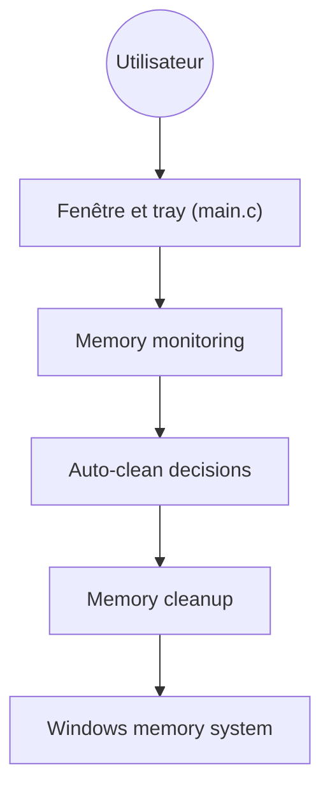

# henrypp/memreduct

> Small Windows utility that monitors and frees system memory, for PCs with tight RAM.

## The problem
A Windows PC's memory fills up with caches and standby pages, with no simple way to empty them.

## What it actually does
Shows memory usage (window or system tray) and clears, on demand or automatically based on threshold and duration, the working set, file caches, and the standby and modified lists. Relies on undocumented internal Windows functions (Native API); the claimed gain varies, from 10 to 50%. All the application code is in `main.c`.

## How it is wired


## Trying it
Portable version: create `memreduct.ini` in the application folder. No other command in the README.
```bash
# installateur ou version portable, droits administrateur requis
```

## Cost and gotchas
Free, GPL-3.0. Administrator rights required. Windows 7 to 11 only. Donations requested.

## What it is not
Not a server monitoring tool. Clearing the cache often forces the system to reload it afterwards, which is not documented here.

## Alternatives
None named in the README.

## For you
Ignore: a Windows desktop utility, unrelated to data, AI or MLOps work.
