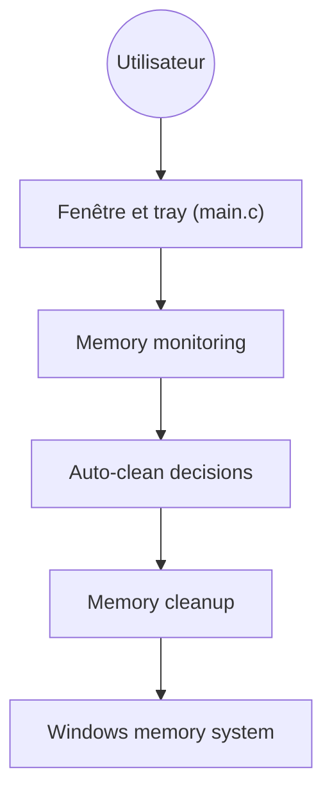

# henrypp/memreduct

> Petit utilitaire Windows qui surveille et libère la mémoire système, pour postes à la RAM juste.

## Le problème
La mémoire d'un poste Windows se remplit de caches et de pages en attente, sans moyen simple de les vider.

## Ce que ça fait vraiment
Affiche l'usage mémoire (fenêtre ou barre système) et vide à la demande ou automatiquement, selon seuil et durée, le working set, les caches de fichiers, les listes standby et modifiées. S'appuie sur des fonctions internes non documentées de Windows (Native API) ; gain annoncé variable, de 10 à 50 %. Tout le code applicatif est dans `main.c`.

## Comment c'est branché


## Essayer
Version portable : créer `memreduct.ini` dans le dossier de l'application. Aucune autre commande dans le README.
```bash
# installateur ou version portable, droits administrateur requis
```

## Coût et pièges
Gratuit, GPL-3.0. Droits administrateur requis. Windows 7 à 11 uniquement. Dons demandés.

## Ce que ce n'est pas
Pas un outil de supervision serveur. Vider le cache force souvent le système à le recharger ensuite, ce qui n'est pas documenté ici.

## Alternatives
Aucune nommée dans le README.

## Pour toi
Ignorer : utilitaire de poste Windows, sans rapport avec un travail data, IA ou MLOps.

