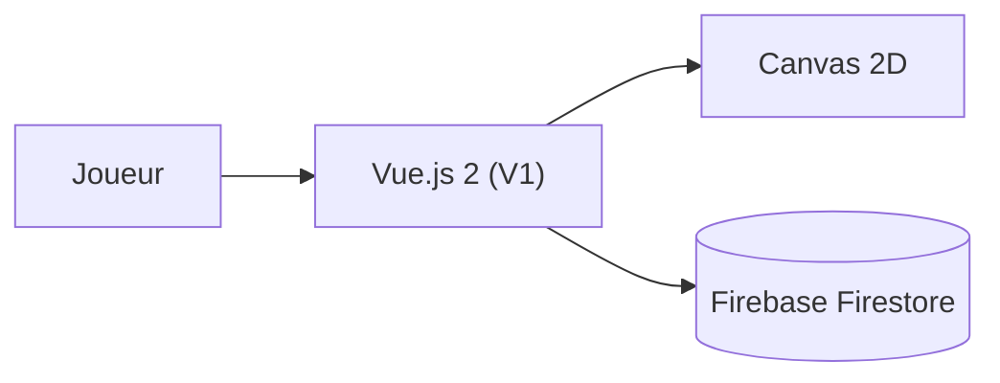

# henryzt/Rhythm-Plus-Music-Game

> Vertical-scrolling web rhythm game with a level editor, for players and creators.

## The problem
Online rhythm games offer few ways to create and share your own levels.

## What it actually does
A game playable in the browser with a chart editor, community sharing, synced favorites and playlists, customizable skins. This repository contains version V1 (Vue.js 2, Canvas 2D, Firebase Firestore). V2 (Nuxt 3, PixiJS, Babylon.js) is not open.

## How it is wired
Simplified diagram based on the sheet, no diagram provided.

## Trying it
No documented command: the README points to the online game (Play Now) and the wiki.

## Cost and gotchas
Free to play. Depends on Firebase for syncing. The repository is a so-called legacy version.

## What it is not
Not the V2 of the game, which remains closed. The repository does not document its local installation.

## Alternatives
No alternative named in the README.

## For you
Ignore: a web game unrelated to data or AI, and code from an end-of-life version.
