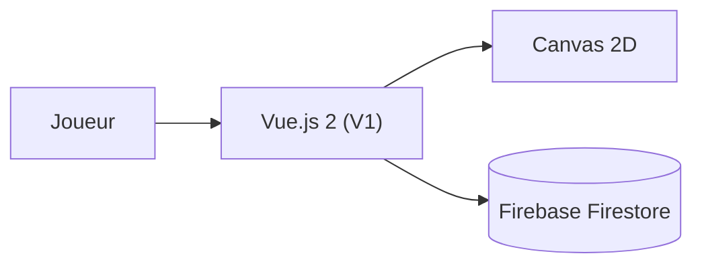

# henryzt/Rhythm-Plus-Music-Game

> Jeu de rythme web à défilement vertical avec éditeur de niveaux, pour joueurs et créateurs.

## Le problème
Les jeux de rythme en ligne offrent peu de moyens de créer et partager ses propres niveaux.

## Ce que ça fait vraiment
Jeu jouable dans le navigateur avec éditeur de partitions, partage communautaire, favoris et playlists synchronisés, skins personnalisables. Ce dépôt contient la version V1 (Vue.js 2, Canvas 2D, Firebase Firestore). La V2 (Nuxt 3, PixiJS, Babylon.js) n'est pas ouverte.

## Comment c'est branché
Schéma simplifié d'après la fiche, sans diagramme fourni.

## Essayer
Aucune commande documentée : le README renvoie au jeu en ligne (Play Now) et au wiki.

## Coût et pièges
Gratuit pour jouer. Dépend de Firebase pour la synchronisation. Le dépôt est une version dite legacy.

## Ce que ce n'est pas
Ce n'est pas la V2 du jeu, qui reste fermée. Le dépôt ne documente pas son installation locale.

## Alternatives
Aucune alternative nommée dans le README.

## Pour toi
À ignorer : jeu web sans rapport avec data ou IA, et code d'une version en fin de vie.

