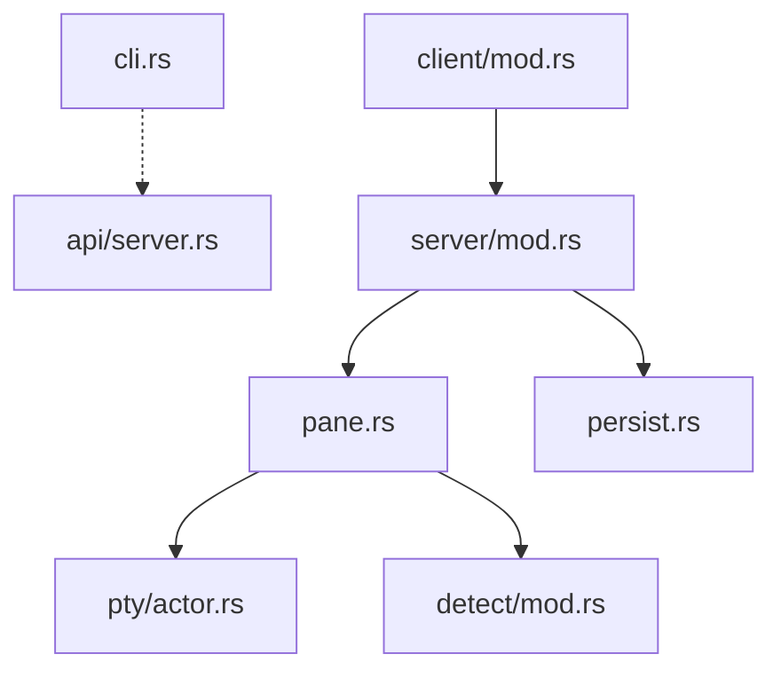

# herdrdev/herdr

> Rust-based terminal multiplexer that keeps your code agents active, detachable, and controllable.

## The problem
Several code agents are running on separate terminals, leading to a loss of session and uncertainty about which agent is waiting for a response.

## What it actually does
A background server has terminals, while a client connects (`Ctrl+B Q` disconnects). Each panel is marked as "working," "blocked," or "idle." Agents control herds via CLI and socket API. It manages remote SSH machines, Git worktrees, and plugins, and restores the layout after a restart (the original processes do not survive).

## How it is wired


## Trying it
```bash
curl -fsSL https://herdr.dev/install.sh | sh
herdr
cargo build --release
```

## Cost and gotchas
Free. The installation script is executed remotely. New repository (created in March 2026), 441 open issues.

## What it is not
Neither an agent nor a replacement for Claude Code: he only possesses their terminals. This is not an identical tmux: the model is specific to herdr.

## Alternatives
There is no alternative mentioned in the README (it implicitly compares itself to tmux based on its keybindings).

## For you
This is useful if you are running multiple agents in parallel or on remote machines; try it out on a disposable workstation and wait for it to mature.
