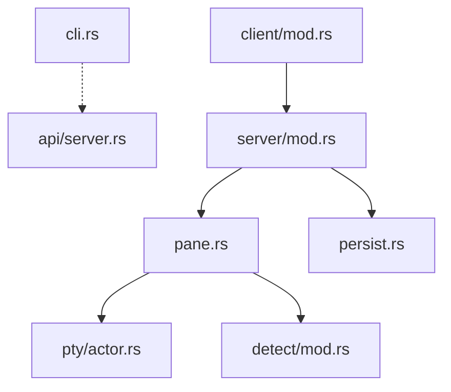

# herdrdev/herdr

> Multiplexeur de terminal en Rust qui garde tes agents de code actifs, détachables et pilotables.

## Le problème
Plusieurs agents de code tournent dans des terminaux dispersés : on perd la session et on ignore lequel attend une réponse.

## Ce que ça fait vraiment
Un serveur en arrière-plan possède les terminaux, un client se rattache (`ctrl+b q` détache). Chaque panneau est marqué working, blocked ou idle. Les agents pilotent herdr par CLI et API socket. Il gère des machines SSH distantes, des worktrees Git, des plugins, et restaure la disposition après redémarrage (les processus d'origine ne survivent pas).

## Comment c'est branché


## Essayer
```bash
curl -fsSL https://herdr.dev/install.sh | sh
herdr
cargo build --release
```

## Coût et pièges
Gratuit. Le script d'installation est exécuté à distance. Nouveau dépôt (créé en mars 2026), 441 issues ouvertes.

## Ce que ce n'est pas
Ni un agent, ni un remplaçant de Claude Code : il possède seulement leurs terminaux. Ce n'est pas un tmux identique : le modèle est propre à herdr.

## Alternatives
Aucune alternative nommée dans le README (il se compare implicitement à tmux par ses touches).

## Pour toi
Utile si tu lances plusieurs agents en parallèle ou sur des machines distantes ; essaie-le sur un poste jetable et attends la maturité.

