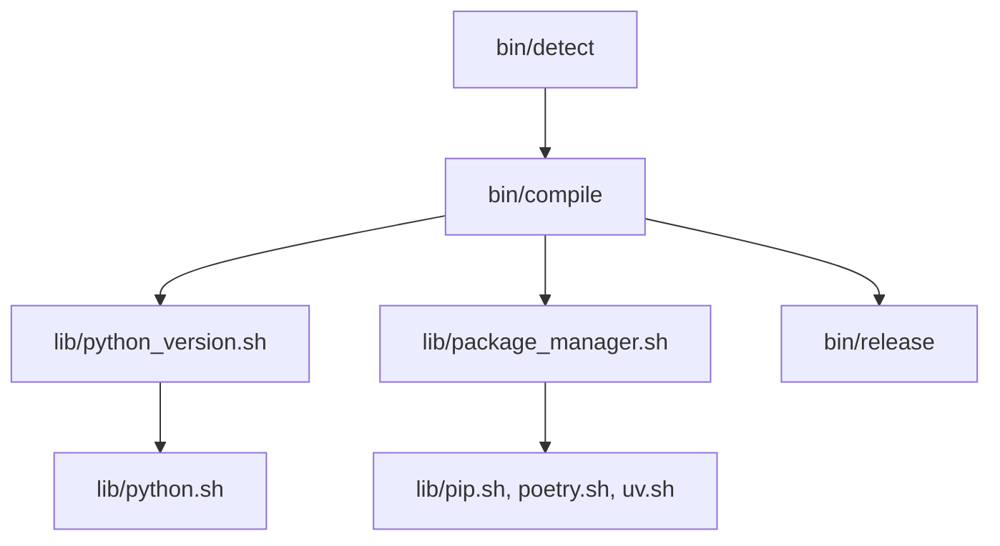

# heroku/heroku-buildpack-python

> Heroku's official buildpack for deploying Python applications, with pip, Poetry or uv.

## The problem
Heroku needs to detect a Python app, pick a version and install its dependencies.

## What it actually does
`bin/detect` recognizes the project, `bin/compile` picks the Python version (`.python-version`, `runtime.txt`, `Pipfile.lock`), installs the runtime then the dependencies via pip, Poetry or uv, and `bin/release` finishes the job. Python 3.12 to 3.15 are supported; 3.10 and 3.11 are deprecated.

## How it is wired


## Trying it
```bash
# Fichier .python-version à la racine de l'appli, contenant par exemple :
# 3.14
```

## Cost and gotchas
Assumes a Heroku account, whose dynos are paid. You need a `requirements.txt`, `Pipfile.lock`, `poetry.lock` or `uv.lock`; uv also requires `.python-version`.

## What it is not
Not a local tool: it runs in Heroku's build chain. Classic version, not the cloud native buildpack.

## Alternatives
- Heroku Cloud Native Buildpack for Python: mentioned in the README as the newer version.

## For you
Ignore, unless you deploy on Heroku: the Python version configuration is well explained, but the platform is an external choice.
