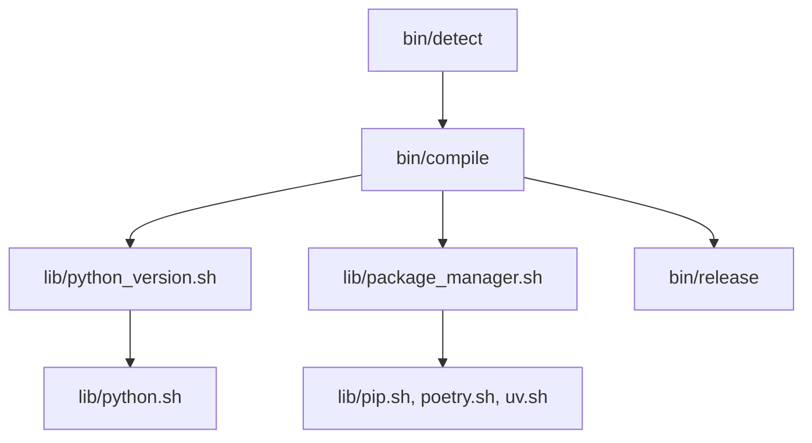

# heroku/heroku-buildpack-python

> Buildpack officiel de Heroku pour déployer des applications Python, avec pip, Poetry ou uv.

## Le problème
Heroku doit savoir détecter une appli Python, choisir une version et installer ses dépendances.

## Ce que ça fait vraiment
`bin/detect` reconnaît le projet, `bin/compile` choisit la version Python (`.python-version`, `runtime.txt`, `Pipfile.lock`), installe le runtime puis les dépendances via pip, Poetry ou uv, `bin/release` termine. Python 3.12 à 3.15 sont pris en charge ; 3.10 et 3.11 sont dépréciés.

## Comment c'est branché


## Essayer
```bash
# Fichier .python-version à la racine de l'appli, contenant par exemple :
# 3.14
```

## Coût et pièges
Suppose un compte Heroku, dont les dynos sont payantes. Il faut un `requirements.txt`, `Pipfile.lock`, `poetry.lock` ou `uv.lock` ; uv exige aussi `.python-version`.

## Ce que ce n'est pas
Pas un outil local : il tourne dans la chaîne de build de Heroku. Version classique, pas le buildpack cloud native.

## Alternatives
- Heroku Cloud Native Buildpack for Python : mentionné dans le README comme version récente.

## Pour toi
Ignorer, sauf si tu déploies sur Heroku : la configuration de version Python est bien expliquée, mais la plateforme est un choix extérieur.

