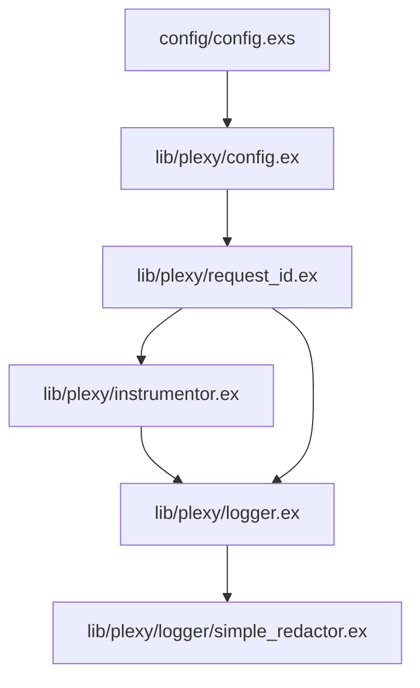

# heroku/plexy

> Elixir plugs for web services with machine-readable logs, request IDs and instrumentation.

## The problem
Without conventions, API logs are hard to trace and can leak secrets.

## What it actually does
Plexy.RequestId adds a request ID, Plexy.Instrumentor times each request, Plexy.Logger writes logs in l2met format along with metrics, and a redactor (SimpleRedactor) hides sensitive keys. Usable in Plug or Phoenix.

## How it is wired


## Trying it
```elixir
{:plexy, "~> 0.3.0"}
plug Plexy.RequestId
plug Plexy.Instrumentor
Plexy.Logger.count(:http_clients_404, 1)
```

## Cost and gotchas
Designed for Librato, Splunk and Rollbax. Version 0.3: little track record.

## What it is not
Not a framework or a code generator; not tied to a database.

## Alternatives
No alternative named (inspired by Pliny).

## For you
Ignore: Elixir plugs, useful only to an Elixir team.
