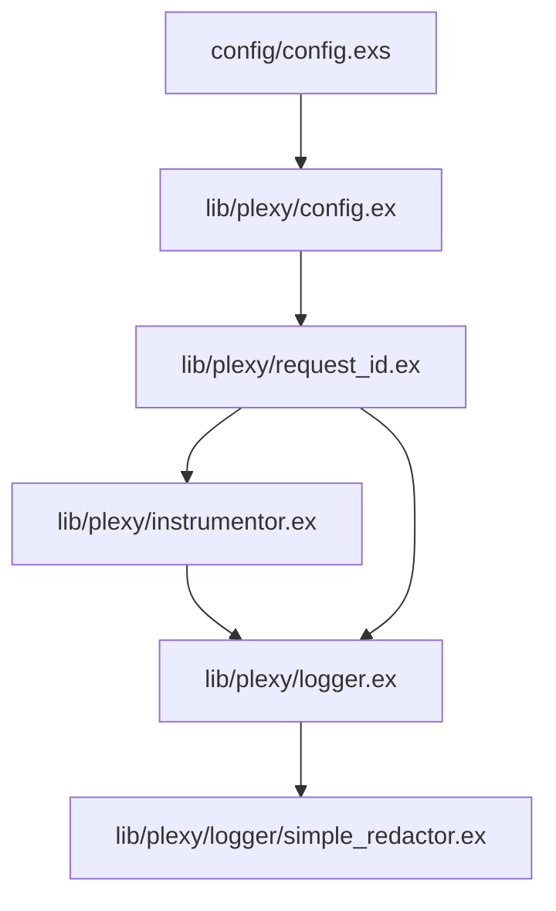

# heroku/plexy

> Plugs Elixir pour des services web avec journaux lisibles par machine, identifiants de requête et instrumentation.

## Le problème
Sans conventions, les journaux d'API sont difficiles à tracer et peuvent laisser fuiter des secrets.

## Ce que ça fait vraiment
Plexy.RequestId ajoute un identifiant de requête, Plexy.Instrumentor chronomètre chaque requête, Plexy.Logger écrit des logs au format l2met et des métriques, et un masqueur (SimpleRedactor) cache des clés sensibles. Utilisable dans Plug ou Phoenix.

## Comment c'est branché


## Essayer
```elixir
{:plexy, "~> 0.3.0"}
plug Plexy.RequestId
plug Plexy.Instrumentor
Plexy.Logger.count(:http_clients_404, 1)
```

## Coût et pièges
Pensé pour Librato, Splunk et Rollbax. Version 0.3 : peu de recul.

## Ce que ce n'est pas
Pas un framework ni un générateur de code ; pas lié à une base de données.

## Alternatives
Aucune alternative nommée (Pliny l'a inspiré).

## Pour toi
À ignorer : plugs Elixir, utiles seulement à une équipe Elixir.

