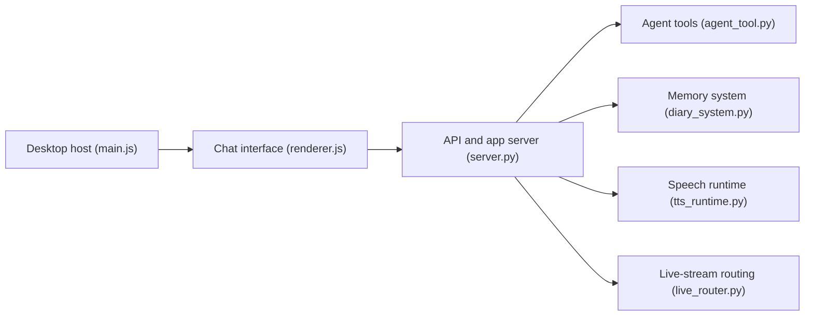

# heshengtao/super-agent-party

> Desktop AI companion with animated avatars, agent tools, memory and messaging bots.

## The problem
Assembling chat, voice, avatar, MCP tools and messaging connectors around an agent takes a lot of pieces.

## What it actually does
Electron application (Windows, macOS, Linux AppImage) or Docker, with a Python server exposing an OpenAI-compatible API and an MCP endpoint. It handles various LLM providers, VRM/THA avatars, VTube Studio, bots (QQ, WeChat, Feishu, Telegram, Discord, Slack), live streaming (Bilibili, YouTube, Twitch), memory, quick commands and an extension system. A computer-control mode (mouse, keyboard, terminal) exists.

## How it is wired

The server/Electron wiring was not extracted from the architecture.

## Trying it
```bash
docker pull ailm32442/super-agent-party:latest
docker run -d -p 3456:3456 -v ./super-agent-data:/app/data ailm32442/super-agent-party:latest
# puis http://localhost:3456/
```

## Cost and gotchas
API keys from your LLM providers. With Docker Compose, default credentials are `root` / `pass`, to be changed. Computer control gives the agent extensive rights.

## What it is not
Not a lightweight framework: huge surface, and several features rely on unstable third-party interfaces (README). AGPL-3.0 license.

## Alternatives
No alternative named in the README.

## For you
Keep an eye on it: a rich showcase but oriented toward companion and streaming use; the AGPL and computer control weigh against professional use.
