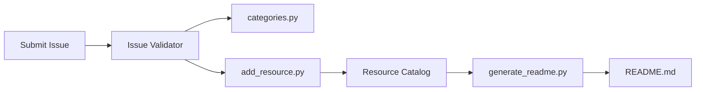

# hesreallyhim/awesome-claude-code

> Annotated list of skills, plugins, hooks and tools for Claude Code, aimed at its users.

## The problem
The Claude Code ecosystem produces hundreds of repositories a month; sorting the serious from the noise takes time.

## What it actually does
A categorized README: guides, Anthropic resources, orchestration, security, memory, observability, status lines, etc.
Each entry carries an editorial comment from the author.
On the code side: a canonical CSV, an issue-based submission validator, `generate_readme.py` which regenerates the README.
A "ticker" fetches GitHub metrics and produces SVGs.

## How it is wired


## Trying it
```bash
# Aucune commande documentée : c'est une liste à lire.
```

## Cost and gotchas
Nothing. The list is being reworked: "legacy" resources are temporarily in `README_ALTERNATIVES`.

## What it is not
Not an exhaustive or neutral catalog: the selection and judgments are those of one person. Not an installable tool.

## Alternatives
Not documented (the README cites resources, not a competing list).

## For you
A good entry point for picking up skills or hooks; to browse, not to adopt.
