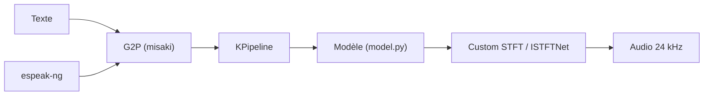

# hexgrad/kokoro

> Inference library for Kokoro-82M, a lightweight open-weights text-to-speech model.

## The problem
Quality TTS models are often large, slow or behind a paid API.

## What it actually does
Provides `KPipeline`: text goes through `misaki` grapheme-to-phoneme conversion, then through the 82-million-parameter model, with an ISTFTNet vocoder, to output 24 kHz audio. Languages: American and British English, Spanish, French, Hindi, Italian, Japanese, Brazilian Portuguese, Mandarin. Falls back to espeak-ng for out-of-dictionary words. A JavaScript version exists.

## How it is wired


## Trying it
```py
!pip install -q kokoro>=0.9.4 soundfile
!apt-get -qq -y install espeak-ng > /dev/null 2>&1
from kokoro import KPipeline
pipeline = KPipeline(lang_code='a')
generator = pipeline(text, voice='af_heart')
```

## Cost and gotchas
Free. espeak-ng must be installed separately (MSI installer on Windows). On Apple silicon Macs, `PYTORCH_ENABLE_MPS_FALLBACK=1` enables the GPU. Last push in August 2025, 209 open issues.

## What it is not
No documented voice cloning: you choose among supplied voices.

## Alternatives
No alternative named in the README.

## For you
Worth watching: lightweight, well-known TTS, Apache-2.0 license, but little activity for a year; pocket-tts is more recent if you want cloning.
