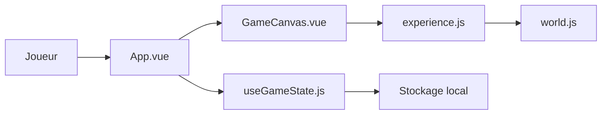

# hexianWeb/CubeCity

> 2.5D city-building web game, in Three.js and Vue, with a cartoon style.

## The problem
A small city-management sandbox playable in the browser, without a heavy engine.

## What it actually does
Four modes (select, build, move, demolish), residential/commercial/industrial balance and ESG, income in coins, local save. Buildings display their states (bonuses, maluses) in rotation. Stack: Vue 3, Three.js, Vite, Pinia, Tailwind.

## How it is wired

## Trying it
No install command in the README; it points to a separate developer guide. Vite stack: `npm install` then launch through the project scripts (not detailed).

## Cost and gotchas
Free. Several systems are listed as future ones (failures, events, technologies).

## What it is not
Not a finished game: most of the challenge mechanics are still to come.

## Alternatives
No alternative cited in the README.

## For you
Ignore: a game demo unrelated to data, AI or MLOps; only the Vue + Three.js pattern could inspire a 3D visualization.
