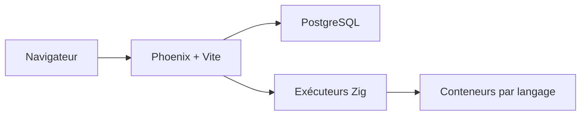

# hexlet-codebattle/codebattle

> Open source programming duel game, developed by the Hexlet community, that you can run locally.

## The problem
Practicing coding in duels requires a platform that safely runs players' code in several languages.

## What it actually does
Phoenix (Elixir) application with a React front end and PostgreSQL. Solutions are checked by Zig runners in separate containers, one per language (js, python, cpp, java, rust, etc.). Interface in English, Russian, Spanish and Chinese; task statements can be translated. A public instance exists at codebattle.hexlet.io.

## How it is wired
Simplified diagram based on the sheet, no diagram provided.


## Trying it
```bash
git clone git@github.com:hexlet-codebattle/codebattle.git
cd codebattle
make setup
make server
make test
```

## Cost and gotchas
Docker is mandatory, on Mac or Linux. The runners are privileged to create their sandboxes: the README asks to put only throwaway credentials in `.env`. Ports 4000 and 8081 may conflict.

## What it is not
Not a data or AI tool: it is an educational game platform. Does not work outside containers.

## Alternatives
No alternative named in the README.

## For you
Ignore: unrelated to data or MLOps, useful only if you want to run coding challenges.
