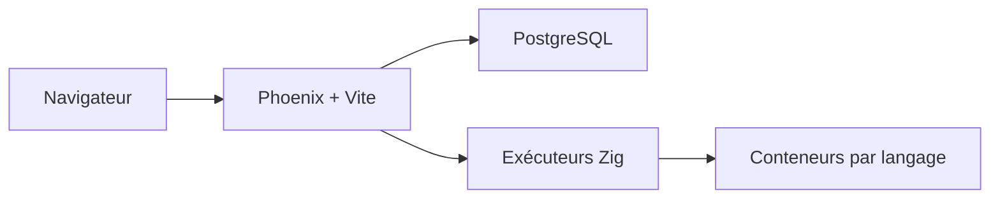

# hexlet-codebattle/codebattle

> Jeu open source de duels de programmation, développé par la communauté Hexlet, que tu peux faire tourner en local.

## Le problème
S'entraîner à coder en duel demande une plateforme qui exécute en sécurité le code des joueurs dans plusieurs langages.

## Ce que ça fait vraiment
Application Phoenix (Elixir) avec un front React et PostgreSQL. Les solutions sont vérifiées par des exécuteurs Zig dans des conteneurs séparés, par langage (js, python, cpp, java, rust, etc.). Interface en anglais, russe, espagnol et chinois ; les énoncés de tâches sont traduisibles. Une instance publique existe sur codebattle.hexlet.io.

## Comment c'est branché
Schéma simplifié d'après la fiche, sans diagramme fourni.


## Essayer
```bash
git clone git@github.com:hexlet-codebattle/codebattle.git
cd codebattle
make setup
make server
make test
```

## Coût et pièges
Docker obligatoire, sous Mac ou Linux. Les exécuteurs sont privilégiés pour créer leurs bacs à sable : le README demande de ne mettre dans `.env` que des identifiants jetables. Les ports 4000 et 8081 peuvent entrer en conflit.

## Ce que ce n'est pas
Pas un outil de data ni d'IA : c'est une plateforme de jeu pédagogique. Pas de fonctionnement hors conteneurs.

## Alternatives
Aucune alternative nommée dans le README.

## Pour toi
À ignorer : sans rapport avec la data ou le MLOps, utile seulement si tu veux animer des défis de code.

