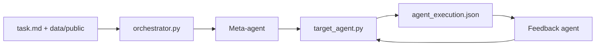

# hexo-ai/sia

> Self-improvement framework where an agent modifies the harness and weights of a target agent, on a benchmark.

## The problem
Improving an agent on a task requires manual cycles of trials, log analysis and rewriting.

## What it actually does
Three roles: a meta-agent creates the target agent from the task description, the target agent attempts the task and logs, a feedback agent analyzes the logs and fixes it. Each generation is scored by `evaluate.py` on private data. Four tasks provided (gpqa, lawbench, longcot-chess, spaceship-titanic) or a custom task. Local web dashboard. Official implementation of a 2026 paper whose gains are the authors' own.

## How it is wired


## Trying it
```bash
pip install 'sia-agent[claude]'
export ANTHROPIC_API_KEY="..."
sia run --task gpqa --max_gen 5 --run_id 1
sia web
```

## Cost and gotchas
API keys at your expense; each generation consumes LLM calls. The `--sandbox none` mode runs generated code with host access; use `--sandbox docker` to isolate it.

## What it is not
Not a product: research code. It improves an agent on a benchmark, with no guarantee of generalization. The weight update is not detailed in the README provided.

## Alternatives
- No alternative named in the README.

## For you
Watch: interesting for studying agent self-improvement, but token-expensive and to be isolated in Docker.
