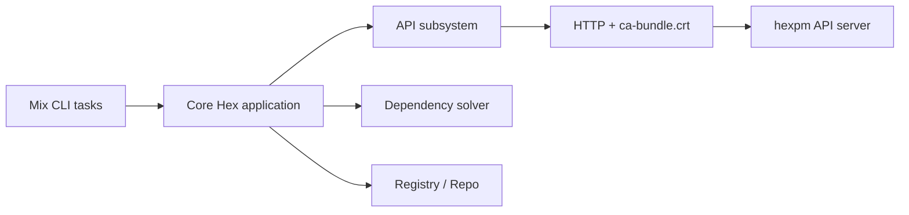

# hexpm/hex

> Package manager for the Erlang/Elixir ecosystem, integrated into Mix.

## The problem
Elixir/Erlang projects need to resolve and download dependencies safely.

## What it actually does
Provides Mix tasks to publish, search and resolve packages. According to the code: an API subsystem (auth, keys, packages, releases, docs), a dependency solver, a registry/repo, HTTP with a CA certificate bundle (`ca-bundle.crt`, updated by `mix certdata`), crypto, and a bit of Erlang. Integration tests target the hexpm server, which must be cloned and run with PostgreSQL.

## How it is wired


## Trying it
```bash
mix certdata
mix test --exclude integration
```
Installation: see hex.pm.

## Cost and gotchas
Free. No license declared in the catalog. Integration tests: local hexpm + PostgreSQL (postgres/postgres).

## What it is not
Not a tool to install separately in a Python project. This repository is the client, not the registry.

## Alternatives
None named in the README.

## For you
Ignore unless you do Elixir: unrelated to a data/AI profile; missing license worth noting.
