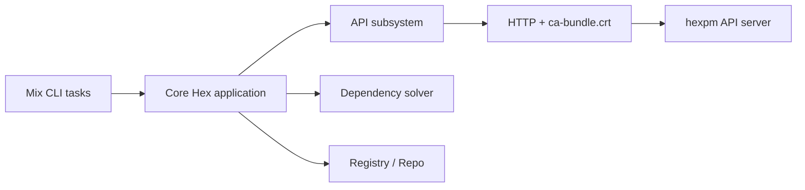

# hexpm/hex

> Gestionnaire de paquets de l'écosystème Erlang/Elixir, intégré à Mix.

## Le problème
Les projets Elixir/Erlang ont besoin de résoudre et télécharger des dépendances de façon sûre.

## Ce que ça fait vraiment
Fournit des tâches Mix pour publier, chercher et résoudre des paquets. D'après le code : sous-système API (auth, clés, paquets, releases, docs), résolveur de dépendances, registre/repo, HTTP avec bundle de certificats CA (`ca-bundle.crt`, mis à jour par `mix certdata`), crypto, un peu d'Erlang. Les tests d'intégration visent le serveur hexpm, à cloner et avec PostgreSQL.

## Comment c'est branché


## Essayer
```bash
mix certdata
mix test --exclude integration
```
Installation : voir hex.pm.

## Coût et pièges
Gratuit. Aucune licence déclarée dans le catalogue. Tests d'intégration : hexpm local + PostgreSQL (postgres/postgres).

## Ce que ce n'est pas
Pas un outil à installer séparément dans un projet Python. Ce dépôt est le client, pas le registre.

## Alternatives
Aucune nommée dans le README.

## Pour toi
À ignorer sauf si tu fais de l'Elixir : sans lien avec un profil data/IA ; licence absente à noter.

