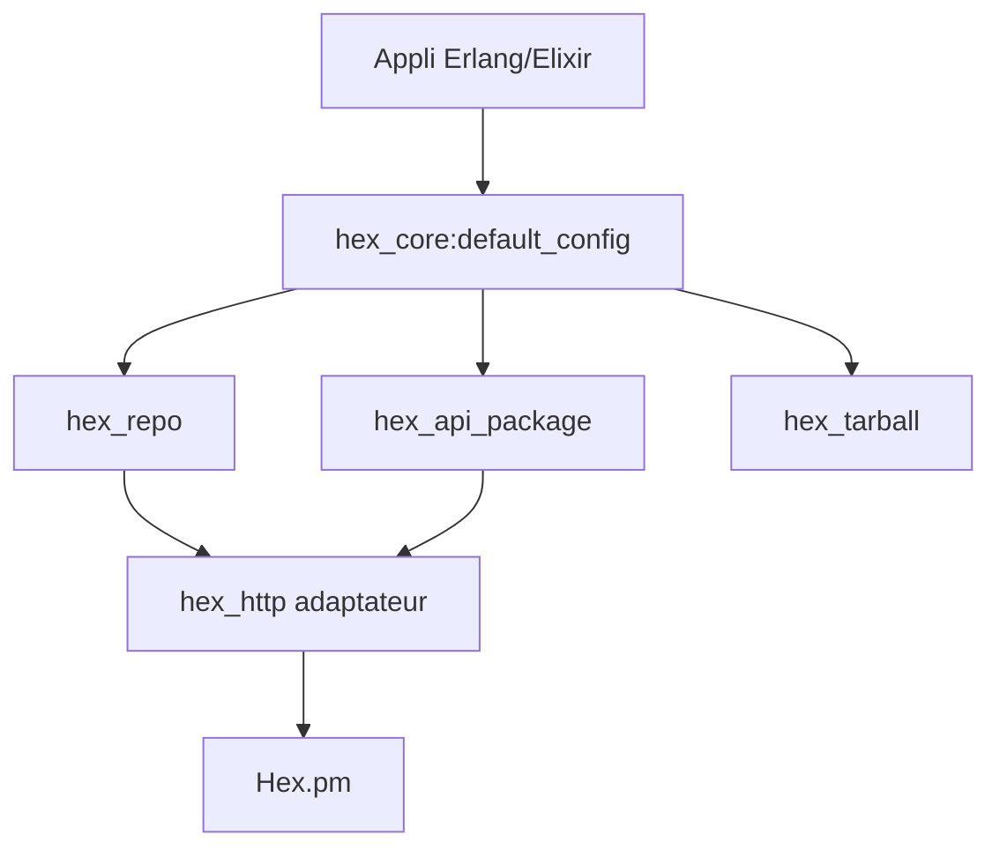

# hexpm/hex_core

> Reference implementation of the Hex specifications in Erlang, for tools that talk to the Hex.pm registry.

## The problem
Talking to the Hex package repository (listing, versions, tarballs, publishing) without rewriting an HTTP client, protobuf and checksum verification.

## What it actually does
Provides Erlang modules: `hex_repo` (names, versions, releases, tarballs), `hex_api_package` (HTTP API, publishing), `hex_tarball` (creation and unpacking with checksums). Handles TOTP 2FA (`api_otp`) and a replaceable HTTP adapter (httpc by default). It is recommended to write a wrapper module for caching and errors.

## How it is wired


## Trying it
```bash
rebar3 as dev compile
rebar3 as test proper
rebar3 ex_doc
```
Dependency: `{hex_core, "0.21.1"}` in `rebar.config`, or `{:hex_core, "~> 0.21.1"}` in `mix.exs`.

## Cost and gotchas
Free. The httpc adapter verifies certificates via `public_key:cacerts_get/0`: HTTPS requests fail on OTP 24 without `ssl` options.

## What it is not
Not a package manager: a building block for writing one. Caching and failure handling are left to the user.

## Alternatives
None named in the README.

## For you
Ignore: Erlang/Elixir ecosystem, unrelated to a daily data / AI / MLOps routine, except for in-house Hex tooling.
